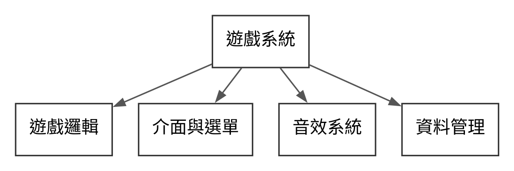

# AOOP 第 1 組期末專題提案補充說明

## 專題名稱與組員

AOOP_Final_Project_Group_1

第 1 組：劉育麟 112511002、張倖嘉 112511004、譚羽良 112511017。

公開 Repo：https://github.com/MoobyMoo/AOOP_Final_Project_Group_1/

正式提案請使用 [PDF](AOOP_Final_Project_Proposal_第1組.pdf) 或 [可編輯 Word](AOOP_Final_Project_Proposal_第1組.docx)。

## 專題動機與目標

我們希望製作一款動作遊戲，結合角色操作、遊戲互動與視聽回饋，提供完整的遊玩體驗。透過遊戲開發，練習物件導向的設計與團隊協作。

本專題採用 Godot 與 GDScript，以既有個人原型為基礎，將遊戲功能劃分為不同模組，使程式便於維護與後續擴充。既有程式與課程期間新增的工作分別記錄，本專題僅用於 AOOP 課程繳交。

## 核心功能與範圍

- 遊戲邏輯：處理角色操作、遊戲互動與流程控制。
- 介面與選單：提供遊戲資訊顯示與操作介面。
- 音效系統：配合遊戲事件提供聲音回饋。
- 資料管理：管理遊戲設定與進度資料。

## 系統架構與物件導向設計

各類別管理自己的資料與行為，透過明確的介面與其他物件互動。相近物件的共用行為以繼承與多型設計，讓不同物件可在相同的使用方式下呈現各自的行為。

遊戲邏輯、介面、音效與資料管理各自負責不同功能，透過事件或方法交換資訊，降低彼此依賴，方便分工與擴充。

## 成員分工

| 組員 | 負責工作 |
| --- | --- |
| 張倖嘉 Michelle／112511004 | UI 與選單的設計、實作與整合 |
| 劉育麟 Jasper／112511002 | SFX 音效的整理、播放功能與整合 |
| 譚羽良／112511017 | 遊戲操作、戰鬥邏輯與系統整合 |

三人各自提交實質程式與驗證紀錄，共同完成架構說明與展示。既有原型保留原作者紀錄，課程貢獻以各自新增或修改的工作說明。

## 繳交與專案狀態

提案截止時間為 2026 年 11 月 16 日 23:59，由組長繳交。繳交檔名為 `AOOP_Final_Project_Proposal_第1組.pdf`，並附公開 Repo 連結。

目前 Repo 收錄提案與組員資料，尚未匯入遊戲程式。提案中的功能為預計工作，尚未在此 Repo 完成遊戲驗證。既有遊戲開發仍維持暫停，本次僅更新提案文件。

## 依據

- 課程公告與官方 Word 範本，保留於 `templates/`。
- [組員資料來源](team.md)。
- [Godot 官方場景組織文件](https://github.com/godotengine/godot-docs/blob/master/tutorials/best_practices/scene_organization.rst)，作為模組責任劃分的依據。
- [Godot 官方 GDScript 文件](https://github.com/godotengine/godot-docs/blob/master/tutorials/scripting/gdscript/gdscript_basics.rst)，作為物件導向、繼承與訊號機制的依據。
