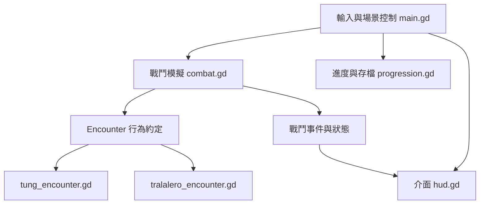

# AOOP 第 1 組期末專題提案草稿

## 專題名稱與組員

**Cappuccino Assassino: Last Order**

第 1 組：劉育麟 112511002、張倖嘉 112511004、譚羽良 112511017。

公開 Repo：https://github.com/MoobyMoo/AOOP-Last-Order

本文件為內容草稿。尚未取得公告所附的 Word 範本，取得後須核對欄位、頁數與版面，再輸出 `AOOP_Final_Project_Proposal_第1組.pdf`。以下規模與分工是建議方案，尚未代表三位組員已同意或完成。

## 一 專題動機與目標

我們希望製作一款第三人稱動作遊戲，讓玩家觀察 Boss 的攻擊前兆，選擇移動、閃避與攻擊時機。玩家扮演自訂的人類劍士，Cappuccino Assassino 則是故事中的 Boss／宿敵。

課程重點是將戰鬥規則、Boss 行為、進度資料與畫面呈現分開。新增一種 Boss 時，應能保留共用戰鬥流程；修改血量與攻擊參數時，也不應同時修改介面或存檔格式。展示時將說明類別責任、物件互動與擴充方式，並提供可重現的驗證步驟。

## 二 技術與課程範圍

採用 Godot 與 GDScript，沿用既有遊戲技術，避免另寫一套引擎。組員已確認課程沒有程式語言或框架限制。實際 Godot 版本與執行方式，在匯入可重現的遊戲版本後固定並記錄。

本專題只繳交 AOOP，不作為其他課程的重複繳交。既有個人遊戲原型將在報告中明確揭露，並以課程期間新增、修改、驗證的工作說明各組員貢獻。

目前這個課程 Repo 只有文件與原始組員檔案，尚未包含遊戲程式。以下提及的既有實作來自個人遊戲工作目錄的文件與原始碼檢查，不代表本 Repo 已可執行，也不代表功能已通過本次測試。遊戲開發仍維持暫停，本次僅整理提案。

## 三 建議的展示範圍

建議先完成一段可在課堂穩定展示的流程：主選單 → 小型探索區 → Boss 戰 → 勝敗結果 → 重試或返回。以兩個行為不同的 Boss 展示共用戰鬥系統的擴充性，例如 Tung 的近距離攻擊與 Tralalero 的水域壓力。

基本驗收包括：

1. 玩家能移動、攻擊與閃避，操作與介面顯示一致。
2. Boss 有可辨識的攻擊前兆、有效攻擊時間與恢復時間。
3. 共用戰鬥系統可切換兩個 Boss 行為物件，不重寫玩家與勝敗流程。
4. 戰鬥能正確進入勝利、失敗與重試狀態。
5. 通關紀錄可儲存，重新啟動後可載入。
6. 提供架構圖、操作說明與實際驗證紀錄。

完整六 Boss 戰役、角色自訂介面、Cappuccino Assassino 宿敵戰及新增美術均不列為本草稿的最低驗收承諾。人類主角的設定保持不變；既有原型仍有舊杯身主角，正式展示前須確認角色與文件一致。最後展示範圍待組員確認。

## 四 系統架構與物件導向設計

下圖是以既有原型為基礎的課程架構草案。箭頭表示呼叫或資料使用方向，事件通知到介面的連接仍須逐一驗證。Encounter 表示共用行為約定，不是自訂的 Boss 基底類別。

| 模組 | 責任與物件關係 | 檢查到的依據 |
| --- | --- | --- |
| 場景控制 | 接收輸入、協調戰鬥與場景生命週期 | `main.gd` 繼承 `Node3D`，有 `start` 等入口 |
| 戰鬥模擬 | 管理生命值、命中與戰鬥狀態，持有一個 Encounter 物件 | `combat.gd` 繼承 `RefCounted`，有 `step`、`select_encounter` 與 `use_encounter` |
| Boss 行為 | 描述特定 Boss 的階段、動作與接觸資訊，供戰鬥模擬使用 | Tung 與 Tralalero Encounter 均繼承 `RefCounted`，有 `reset`、`step_boss` 與 `step_defeat` |
| 進度與儲存 | 管理通關資料、存檔版本與讀寫結果 | `progression.gd` 繼承 `RefCounted`，有 `load_state`、`save_state` 與 `skin_unlocked` 訊號 |
| 介面 | 呈現血量、提示、選單與結果 | `hud.gd` 繼承 `Control` |

物件導向的展示重點如下：

- **封裝**：以方法管理戰鬥與進度狀態，課程工作將檢查外部直接改寫資料的情況，逐步收斂責任。現況仍有公開欄位，不宣稱已完成嚴格封裝。
- **繼承**：說明 `Node3D`、`Control` 與 `RefCounted` 的不同生命週期與用途；只有實際存在的繼承關係才列入成果。
- **多型**：由共用戰鬥流程呼叫不同 Encounter 的同名方法。課程驗證須檢查必要方法與回傳資料，避免把 GDScript 的動態呼叫誤認為編譯期介面保證。
- **組合**：戰鬥系統持有可替換的 Encounter 物件，避免為每個 Boss 複製整套戰鬥程式。
- **事件通知**：利用既有訊號機制傳達事件，並檢查介面連接與場景重啟時是否重複註冊。既有戰鬥訊號包含 `confirmed_final_contact`；不假設所有介面已採用事件驅動。

Godot 官方的場景組織文件建議讓物件各自負責明確功能並降低耦合，因此本案以既有模組分工與可替換行為為架構基礎。官方 GDScript 文件確認語言支援物件導向、繼承與訊號，這些機制足以支撐上述課程展示。

## 五 建議分工

下表僅為討論起點。每人需親自完成可辨識的程式與驗證工作，不以美術整理或報告撰寫作為唯一貢獻。

| 組員 | 建議工作 | 驗收證據 |
| --- | --- | --- |
| 劉育麟 | Boss 行為與階段流程、第二種 Encounter 的共用約定檢查 | 兩種 Boss 差異展示、行為驗證與 PR |
| 張倖嘉 | 進度與存檔、選單與勝敗介面整合 | 儲存載入與損壞資料案例、重試流程與 PR |
| 譚羽良 | 共用戰鬥流程、模組介面整理與整合 | 命中與閃避規則、可重現執行說明與整合 PR |

三人共同檢查架構圖、示範腳本與報告。既有程式的作者與歷史保持原樣，不追溯替他人建立貢獻。

## 六 時程與版本控制

| 階段 | 預計內容 | 完成條件 |
| --- | --- | --- |
| 11 月 8 日至 10 日 | 確認範本、組長、組內分工與展示範圍 | 組員完成提案內容核對 |
| 11 月 11 日至 13 日 | 檢查架構、既有成果與課程新增工作界線 | 架構圖與文件描述一致 |
| 11 月 14 日至 15 日 | 套用官方範本、檢查公開 Repo 連結與 PDF | PDF 欄位、組員與連結核對完成 |
| 11 月 16 日 23:59 前 | 組長繳交提案 | 檔名為 `AOOP_Final_Project_Proposal_第1組.pdf` |
| 提案後至期末展示 | 依確認的期末日期安排實作、整合與驗證 | 以課程公告日期為準，不臆造期末期限 |

使用 Issue、分支與 Pull Request 記錄實質工作。每個 Commit 應描述實際變更，持續提交可檢查的成果；不集中在截止前一次補交，也不製造空白或灌水 Commit。

## 七 驗證與風險

以下是實作後必須執行的驗收計畫，本次文件整理尚未執行遊戲測試。

| 項目 | 驗證方式 | 通過條件 |
| --- | --- | --- |
| 命中與閃避 | 對固定輸入與時間步驟檢查戰鬥結果 | 攻擊有效期間以外不造成傷害，閃避規則與設計一致 |
| Boss 可替換性 | 以同一套戰鬥流程載入兩個 Encounter | 必要方法可呼叫，資料格式一致，皆能完成勝敗流程 |
| 狀態重置 | 勝利、失敗後各重試至少三次 | 生命值、計時器與事件連接不殘留前一場狀態 |
| 進度持久化 | 儲存後關閉並重新啟動 | 通關紀錄一致，缺少或損壞存檔時有明確處理 |
| 環境重現 | 其他組員以乾淨環境依 README 執行 | 能使用指定引擎版本完成一段展示流程 |
| 貢獻可追溯 | 檢查 Issue、PR、Commit 與驗證紀錄 | 各組員能解釋自己的設計、修改與檢查結果 |

主要風險是既有原型範圍過大、角色設定與舊程式不一致，以及美術資產的公開授權。匯入公開 Repo 前，須確認資產可公開的權利並排除憑證、快取與不相關工作檔；未確認授權的素材不直接公開。優先完成可重現的課程展示，再考慮擴充完整戰役。

## 八 依據與待補資料

- 課程公告截圖：11 月 16 日 23:59 截止、公開 Repo、OOP 與架構圖、原創性與 Commit 貢獻規範。
- [第 1 組組員核對來源](team.md)。
- 個人遊戲原型：`game/scripts/main.gd`、`combat.gd`、`progression.gd`、`hud.gd` 與 `encounters/`，於 2026 年 11 月 8 日做靜態檢查，尚未複製至本 Repo。
- 個人遊戲決策紀錄：`docs/slice/design-decisions.md` 與 `docs/hero-map-art-status-2026-11-08.md`，確認人類主角、Assassino 宿敵角色及開發暫停狀態。
- [Godot 官方場景組織文件](https://docs.godotengine.org/en/stable/tutorials/best_practices/scene_organization.html)。官方網站本次回傳 403，實際核對的是[官方文件原始碼](https://github.com/godotengine/godot-docs/blob/master/tutorials/best_practices/scene_organization.rst)。
- [Godot 官方 GDScript 文件](https://github.com/godotengine/godot-docs/blob/master/tutorials/scripting/gdscript/gdscript_basics.rst)。

待補：公告所附的官方 Word 範本、組長／繳交人、組員對分工與最低展示範圍的確認。原始碼與資產的匯入另行安排，不因本提案自動恢復遊戲開發。
